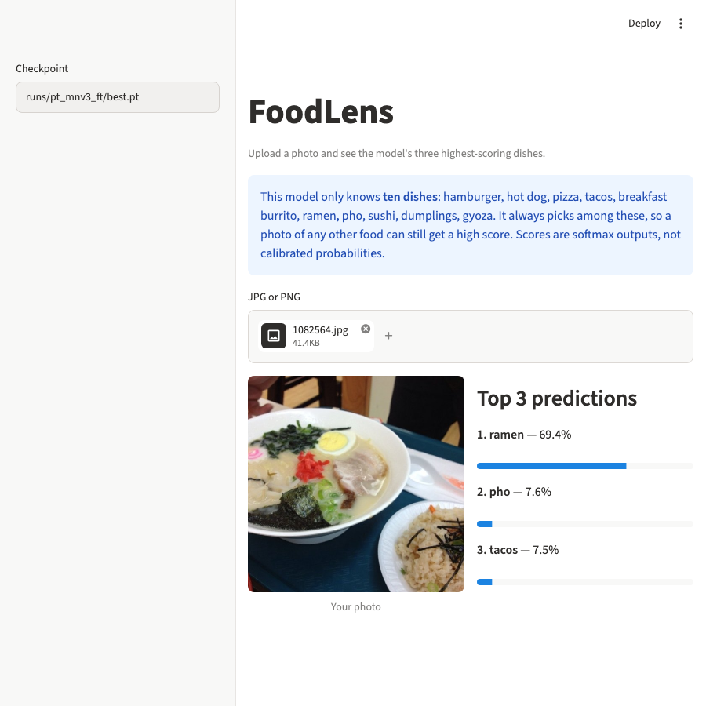
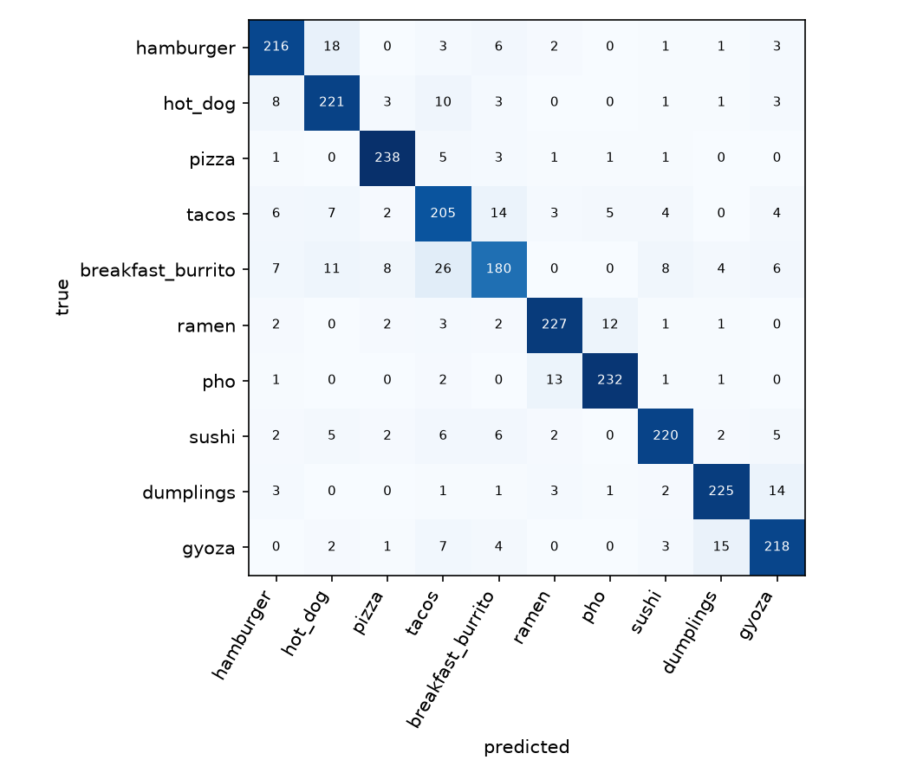

# FoodLens

Photo classifier for ten dishes from Food-101. Upload an image, get the three highest-scoring classes with model scores.
Trains a small CNN end to end in PyTorch, reproduces it in Keras, and compares both against a transfer-learned MobileNetV3-Small, all on the same split.

**Classes:** hamburger, hot_dog, pizza, tacos, breakfast_burrito, ramen, pho, sushi, dumplings, gyoza (see [configs/classes.txt](configs/classes.txt); line number = class ID). Dumplings vs. gyoza is the pair to inspect in the confusion matrix.



**Headline:** fine-tuned MobileNetV3-Small reaches **87.3% top-1 / 97.2% top-3 / 0.872 macro-F1** on the 2,500 official test images; the from-scratch 3-block CNN (15 epochs) reaches 39-45% top-1. The demo serves the fine-tuned MobileNetV3-Small.

## Dataset

[Food-101](https://data.vision.ee.ethz.ch/cvl/datasets_extra/food-101/) (~5 GB; not included in this repo - download it from the original source and extract to `data/food-101/`).

> Bossard, L., Guillaumin, M., Van Gool, L. *Food-101 – Mining Discriminative Components with Random Forests.* European Conference on Computer Vision (ECCV), 2014.

Download and extract (see the dataset page above for the current archive link):

```bash
curl -L -o data/food-101.tar.gz https://data.vision.ee.ethz.ch/cvl/food-101.tar.gz
tar -xzf data/food-101.tar.gz -C data/    # creates data/food-101/{images,meta}
```

Split: the official 750 train images per class become 600 train / 150 val using seed 42; the official 250 test images per class are the test set. Totals: 6,000 / 1,500 / 2,500.

```bash
python scripts/make_split.py --food101-dir data/food-101 --seed 42   # writes data/manifest.csv (path, class_id, split)
```

## Setup

```bash
python -m venv .venv && source .venv/bin/activate
pip install -r requirements.txt
pip install -r requirements-extra.txt   # Keras comparison + optional ONNX
pytest
```

## Preprocessing (identical in training, evaluation, serving)

[foodlens/data.py](foodlens/data.py): convert to RGB, PIL bilinear resize, scale to [0, 1]. Random horizontal flip is training-only.

| Model | Input |
|---|---|
| CNN (PyTorch, Keras) | squash-resize to 128 x 128, [0, 1] |
| MobileNetV3-Small | resize 256, center-crop 224, [0, 1], ImageNet mean/std (what the pretrained weights require) |

## Train

```bash
# 1. sanity check: overfit one random batch of 32 (loss 2.33 -> 0.008 in 500 steps; see docs/overfit_check.txt)
python -m foodlens.train_torch --arch cnn --overfit-batch

# 2. PyTorch CNN: AdamW, lr 1e-3, batch 32, 15 epochs, best val macro-F1 checkpoint
python -m foodlens.train_torch --arch cnn --name pt_cnn

# 3. Keras twin: same split, architecture, scaling, schedule, checkpoint rule
python -m foodlens.train_keras --name keras_cnn

# 4. MobileNetV3-Small: frozen backbone, train head
python -m foodlens.train_torch --arch mobilenet --name pt_mnv3
# 4b. optional: unfreeze last feature block, lower LR
python -m foodlens.train_torch --arch mobilenet --unfreeze-last --lr 1e-4 --epochs 10 \
    --init-from runs/pt_mnv3_ft/best.pt --name pt_mnv3_ft
```

Each run writes `runs/<name>/{config.json, log.csv, best.*}` (seed, hyperparameters, device used, library versions; per-epoch train loss, val loss, val macro-F1). Checkpoints are git-ignored except the final demo model (`runs/pt_mnv3_ft/best.pt`).

## Evaluate

Pick checkpoints and augmentation using `--split val`. Run `--split test` once, after those choices are locked.

```bash
python -m foodlens.evaluate --framework torch --checkpoint runs/pt_cnn/best.pt   --split test --out results/pt_cnn
python -m foodlens.evaluate --framework keras --checkpoint runs/keras_cnn/best.keras --split test --out results/keras_cnn
python -m foodlens.evaluate --framework torch --checkpoint runs/pt_mnv3_ft/best.pt  --split test --out results/pt_mnv3
python scripts/make_results_table.py
```

Outputs per model: `metrics.json` (top-1, top-3, macro-F1, per-class recall, confusion matrix), `confusion_matrix.png`, `mistakes.csv` (10 most confident errors with true label, predicted label, score).

## Results (official test set, 2,500 images, each checkpoint evaluated once after selection on validation)

| Model | Device | Epochs | Best val macro-F1 | Test top-1 | Test top-3 | Test macro-F1 |
|---|---|---|---|---|---|---|
| PyTorch CNN (`pt_cnn`) | MPS (M-series) | 15 | 0.377 | 0.391 | 0.700 | 0.373 |
| Keras CNN (`keras_cnn`) | CPU | 15 | 0.412 | 0.446 | 0.742 | 0.438 |
| MobileNetV3-Small, frozen head (`pt_mnv3`) | MPS | 15 | 0.840 | 0.864 | 0.970 | 0.864 |
| **MobileNetV3-Small, last block fine-tuned (`pt_mnv3_ft`, demo model)** | MPS | 15 + 10 | 0.842 | **0.873** | **0.972** | **0.872** |

Selection rule: best validation macro-F1 per run, then fine-tuned over frozen MobileNet because it scored higher on validation (0.842 vs 0.840 - a small gap, within what seed noise could explain; the test gap of ~0.9 pt points the same way). The frozen-head test numbers are reported for transparency, not used for selection. Fine-tuning: last feature block unfrozen, lr 1e-4, 10 epochs, started from the frozen-head checkpoint. Single seed (42) per model; no confidence intervals.

Per-class test recall (order: hamburger, hot_dog, pizza, tacos, breakfast_burrito, ramen, pho, sushi, dumplings, gyoza):

| Model | ham | hot_dog | pizza | tacos | burrito | ramen | pho | sushi | dump | gyoza |
|---|---|---|---|---|---|---|---|---|---|---|
| PyTorch CNN | .22 | .40 | .57 | .10 | .43 | .40 | .73 | .36 | .60 | .09 |
| Keras CNN | .28 | .49 | .58 | .36 | .22 | .54 | .69 | .41 | .68 | .20 |
| MobileNetV3 (fine-tuned) | .86 | .88 | .95 | .82 | .72 | .91 | .93 | .88 | .90 | .87 |

### Confusion matrix (fine-tuned MobileNetV3-Small, test)



Dumplings vs. gyoza: 14 dumplings predicted as gyoza and 15 gyoza as dumplings (of 250 each) - among the larger error pairs, behind breakfast burrito -> tacos (26) and hamburger -> hot_dog (18). Breakfast burrito is the weakest class (0.72 recall). The Keras CNN confuses them more (28 gyoza -> dumplings). CNN matrices: [PyTorch](docs/confusion_matrix_pt_cnn.png), [Keras](docs/confusion_matrix_keras.png).

### Example mistakes (fine-tuned MobileNetV3-Small, most confident errors; full list in `results/pt_mnv3_ft/mistakes.csv`)

| Image | True | Predicted | Score |
|---|---|---|---|
| pho/2492476 | pho | ramen | 0.991 |
| hamburger/642418 | hamburger | hot_dog | 0.986 |
| dumplings/1480996 | dumplings | gyoza | 0.977 |
| hot_dog/2913086 | hot_dog | hamburger | 0.968 |
| gyoza/2302720 | gyoza | hot_dog | 0.962 |
| sushi/110811 | sushi | hot_dog | 0.962 |
| dumplings/3905871 | dumplings | gyoza | 0.938 |

Several errors carry >0.95 scores, so the softmax score is not a reliable confidence signal.

### PyTorch vs. Keras: differences that affect interpretation

- **The Keras CNN scoring higher (0.438 vs 0.373 macro-F1) is not evidence Keras is better.** Both models are still improving at epoch 15, single seed, and val macro-F1 swings by several points between epochs (see `runs/*/log.csv`), so a gap this size is plausibly noise plus initialization.
- **Initialization:** PyTorch conv/linear default is Kaiming-uniform (a=sqrt(5)); Keras default is Glorot-uniform with zero biases. Not matched.
- **Device:** PyTorch ran on Apple MPS; TensorFlow ran on CPU only (no GPU plugin installed). Wall-clock was 866 s (PyTorch, MPS) vs 1,369 s (Keras, CPU) - **not comparable**, so no speed conclusion is drawn.
- **Data order / flips:** both seeded (42), but RNG streams differ, so batches and flips are not identical. Preprocessing is the same code path (identical PIL bilinear resize to 128x128 and [0,1] scaling; flip training-only).
- **Optimizer:** AdamW, lr 1e-3, weight decay 0.01 in both; implementations are not bit-identical.
- **Augmentation:** only horizontal flip was used. Flip on/off was not ablated on validation.

### Transfer learning vs. from scratch

MobileNetV3-Small starts from ImageNet weights (which already include many food/dish categories) and uses its own preprocessing (256 resize, 224 center crop, ImageNet normalization), versus a randomly initialized 3-block CNN at 128x128 - so the 40+ point gap reflects pretraining and input resolution together, not architecture alone. The center crop can also cut off food at image edges.

## Demo

```bash
FOODLENS_CKPT=runs/pt_mnv3_ft/best.pt streamlit run app/streamlit_app.py
```

The page takes a JPG/PNG upload, previews it, shows three ranked predictions, and warns that only ten dishes are supported and unsupported foods may still get high scores.

Screenshot above (`docs/demo.png`). Verified by uploading test images through a headless browser (pizza -> pizza 96.7%, ramen -> ramen 69.4%).

**Model chosen for the demo:** fine-tuned MobileNetV3-Small (`runs/pt_mnv3_ft/best.pt`, 3.7 MB, committed so the demo runs after a clone): highest validation macro-F1, and 87.3% top-1 on test versus 39-45% for the from-scratch CNNs. Caveat: the model only knows ten dishes and was evaluated only on Food-101 photos, not arbitrary phone photos.

## Optional: ONNX parity

```bash
python scripts/export_onnx.py --checkpoint runs/pt_mnv3_ft/best.pt
```

Compares PyTorch and ONNX Runtime logits on 50 validation inputs (tolerance `--atol`, default 1e-4) and top-1 agreement; benchmarks CPU latency only if parity passes. Result (fine-tuned MobileNetV3-Small, 50 validation inputs, `results/onnx_parity.txt`): max |logit difference| 2.6e-05 (tolerance 1e-4), 100% top-1 agreement. Single-image CPU latency after parity passed (p50/p95, 100 runs, M-series Mac): PyTorch 74.8 / 92.4 ms, ONNX Runtime 5.3 / 10.6 ms.

## Tests

`pytest` covers class ID mapping, preprocessing (shape, range, RGB conversion, normalization), model output shapes, and split reproducibility/sizes.
